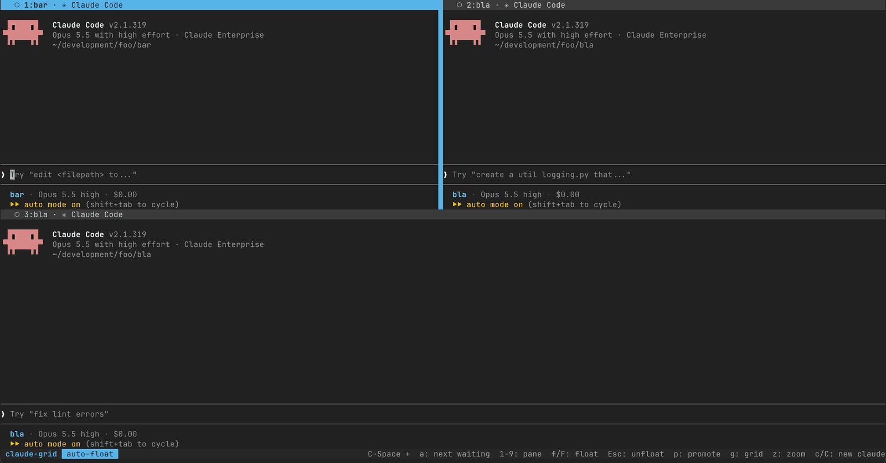
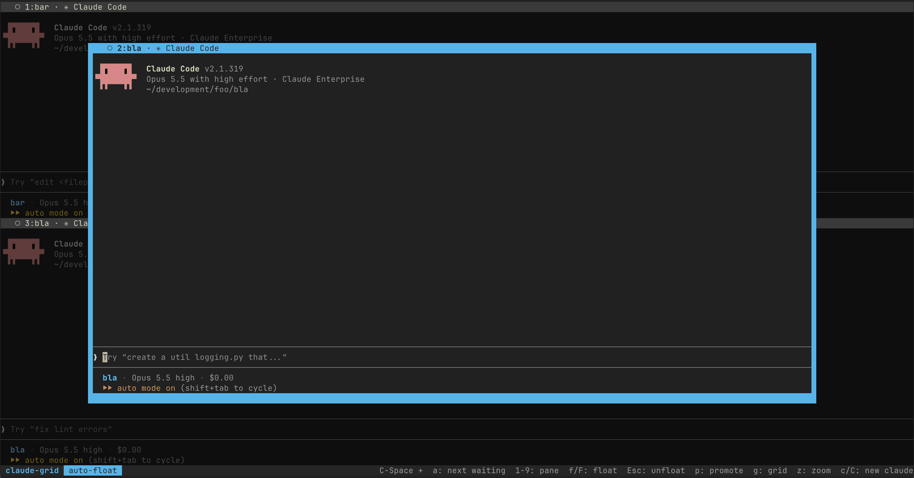

# Claude Grid

```
  ██  ██   ┏━╸╻  ┏━┓╻ ╻╺┳┓┏━╸   ┏━╸┏━┓╻╺┳┓
           ┃  ┃  ┣━┫┃ ┃ ┃┃┣╸ ╺━╸┃╺┓┣┳┛┃ ┃┃
  ██  ██   ┗━╸┗━╸╹ ╹┗━┛╺┻┛┗━╸   ┗━┛╹┗╸╹╺┻┛
```

Run several [Claude Code](https://code.claude.com) sessions side by side in one terminal window,
and see at a glance which one needs you.

`claude-grid ~/api ~/web ~/infra` opens a tiled grid with one Claude per folder. Each pane's
border shows its state: **⚠ NEEDS INPUT** in orange when Claude asks a question or wants
permission, **● working**, or **✓ done**. One key jumps to the next session waiting on you.
Another floats the focused session over the grid, large and centered, with the rest faded
behind it.

<p>
  <a href="docs/images/grid.png"></a>
  <a href="docs/images/floating-pane.png"></a>
  <br>
  <sub>Three sessions in a grid, and the same grid with one session floating. Click either to enlarge.</sub>
</p>

## It doesn't change your terminal setup

claude-grid uses [tmux](https://tmux.github.io) to draw the grid, but you don't have to use tmux, know tmux, or change
anything about how you work today if you're an existing tmux user.

- **tmux runs only while a grid is open.** Close the grid and no tmux is left running.
- **Your tmux config is never read or changed.** Each grid runs on its own private tmux server
  (`tmux -L claude-grid-<name>`) with its own config file (`tmux -f`), so `~/.tmux.conf`, your
  key bindings and your tmux sessions are untouched. If you already use tmux, the two servers
  don't share anything.
- **Your Claude Code settings are never changed.** The hooks that report each session's state
  are passed to each pane with `claude --settings`, which adds settings for that session only.
  `~/.claude/settings.json` and your project settings stay as they are.
- **Nothing goes in your shell rc files.** The installer adds one command to `~/.local/bin` (plus a
  second name, if you ask for one with `--alias`), and `./install.sh --uninstall` removes it.

The only files claude-grid writes:

| Path | What |
|---|---|
| `~/.local/bin/claude-grid` | the command (a link to this checkout, or a copy) |
| `~/.config/claude-grid/config` | your settings, only if you change any |
| `~/.local/state/claude-grid/` | the tmux config and hooks file, regenerated on every run |

`XDG_CONFIG_HOME` and `XDG_STATE_HOME` move the last two.

## Requirements

- **macOS** (Linux should work, but isn't tested yet)
- **tmux 3.8 or newer**, for floating panes: `brew install tmux`
- **Claude Code** (`claude` on your PATH)
- bash 3.2 or newer (the one macOS ships is fine)
- jq (optional; macOS ships it). Without it, question prompts are detected with a simpler text match.

## Install

```sh
git clone https://github.com/amokan/claude-grid.git
cd claude-grid
./install.sh
```

The installer checks the requirements, links `~/.local/bin/claude-grid` to the checkout, and
offers to open the settings menu.

| Option | Effect |
|---|---|
| `--copy` | copy the files instead of linking, so the checkout can be moved or deleted |
| `--prefix DIR` | install under `DIR` instead of `~/.local` |
| `--alias NAME` | also install claude-grid under a second, shorter name, if no command on PATH uses it (a shell alias or function with that name still takes precedence) |
| `-y` | accept the defaults without asking |
| `--uninstall` | remove claude-grid (your settings stay in `~/.config/claude-grid`) |

Run `claude-grid doctor` to check the setup.

## Upgrade

The default install links to your checkout, so upgrading is a pull:

```sh
cd claude-grid
git pull
```

If you installed with `--copy`, run the installer again after pulling, with the same options
(for example `./install.sh --copy`, plus `--prefix` if you used one).

Upgrades never touch your settings in `~/.config/claude-grid`. Settings added in a new version
start at their defaults, so nothing changes until you turn them on; `claude-grid config` lists
them.

Grids that are already open keep running, and their Claude sessions aren't restarted. They
switch to the new version the next time you run `claude-grid` in them, or press the prefix and
`r`. Run `claude-grid doctor` afterwards to check the setup.

## Uninstall

From the checkout:

```sh
claude-grid kill --all       # end any running grids first
./install.sh --uninstall     # add the same --prefix if you installed with one
```

`--uninstall` removes:

- the `claude-grid` command (`~/.local/bin/claude-grid`)
- any second name you added with `--alias`
- the copied support files, if you installed with `--copy` (`~/.local/libexec/claude-grid`)
- the generated tmux config and hooks file (`~/.local/state/claude-grid`)

It keeps your settings and themes in `~/.config/claude-grid`, and the checkout itself.

### Removing it by hand

If the checkout is gone, or you'd rather not run the script, these are all the places
claude-grid writes to (with the default `~/.local` prefix and XDG folders):

```sh
claude-grid kill --all                # end any running grids
rm ~/.local/bin/claude-grid           # the command: a link to the checkout, or a copy
rm ~/.local/bin/NAME                  # only if you added a second name with --alias NAME
rm -rf ~/.local/libexec/claude-grid   # only if you installed with --copy
rm -rf ~/.local/state/claude-grid     # generated files, rebuilt on every run
rm -rf ~/.config/claude-grid          # your settings and themes
rm -rf ~/path/to/claude-grid          # the checkout
```

There's nothing else to undo: claude-grid never touches your shell rc files, your
`~/.tmux.conf` or tmux sessions, or your Claude Code settings. Ended grids can leave empty
socket files named `claude-grid-*` in tmux's socket folder (`/tmp/tmux-<your user id>/`
by default); they're harmless.

## Usage

```sh
claude-grid                       # re-attach a detached grid, or start one with a pane here
claude-grid ~/api ~/web           # one Claude pane per folder
claude-grid ~/api:3 ~/web:2       # three panes in ~/api, two in ~/web
claude-grid -n 4                  # four panes in the current folder
claude-grid ~/api --model opus    # start the new panes on a specific model
claude-grid ~/api:4 --minimal-status   # a one-line Claude statusLine in the new panes
```

Running `claude-grid DIR` while a grid is open adds panes to it.

### A shorter statusLine

A multi-line Claude statusLine takes a lot of room in a small pane, so claude-grid can give
panes a one-line statusLine instead. It's off by default: panes show your own statusLine,
unchanged.

- `--minimal-status` turns it on for the panes that run starts.
- `MINIMAL_STATUS=true` in your [settings](#settings) turns it on for every new pane, including
  the ones you add with `c` and `C` inside a grid. `--no-minimal-status` then turns it off for
  one run.

```
api · main · Opus 5.5 high · 42% context · $1.23
```

In a worktree session the folder shows the worktree's name, e.g. `api [bright-running-fox]`.
The line needs jq to read what Claude sends it; without jq it shows only the folder and branch.

To use your own short statusLine instead of claude-grid's, set `MINIMAL_STATUS_COMMAND` to
its command (see [Settings](#settings)). It gets the same JSON on stdin as any
[Claude statusLine](https://code.claude.com/docs/en/statusline).

Every pane also has `CLAUDE_GRID` set to its grid's name, so your own statusLine script or
hooks can tell they run in a grid, for example to print fewer lines:

```sh
if [ -n "${CLAUDE_GRID:-}" ]; then
  echo "$branch · $model"   # inside claude-grid: one short line
  exit 0
fi
```

### Passing flags to Claude

Everything after `--` goes to `claude` in each pane that run starts:

```sh
claude-grid ~/api:3 -- --worktree               # three Claudes, each in its own git worktree
claude-grid ~/web -- --permission-mode plan --effort high
claude-grid ~/api -- --continue                 # pick up the last conversation in ~/api
```

`--worktree` is worth knowing about: without it, several panes in one folder edit the same
checkout. Leave out the worktree name when a run starts several panes, so Claude gives each
pane its own worktree; with a name, they would all open the same one, so claude-grid refuses
that. It also refuses `--worktree` for a folder that isn't a git repository. New worktrees
branch from the remote's default branch, not your current branch, unless you set Claude Code's
[`worktree.baseRef`](https://code.claude.com/docs/en/worktrees#choose-the-base-branch) to
`"head"`.

For flags you want in every pane, every time, set `CLAUDE_COMMAND` instead (see
[Settings](#settings)).

claude-grid refuses the flags that would break a grid:

| Flag | Why |
|---|---|
| `--bare`, `--safe-mode` | they turn off hooks, so the pane never shows NEEDS INPUT |
| `--settings` | a second `--settings` replaces claude-grid's hooks; put those settings in `~/.claude/settings.json` or the project's `.claude/settings.json` |
| `-p`, `--print` | they answer once and exit |
| `--tmux`, `--bg`, `--cloud`, `--desktop`, `--teleport` | the session runs somewhere other than the pane |
| `-h`, `--help`, `-v`, `--version` | they print and exit |

| Command | |
|---|---|
| `claude-grid attach [NAME]` | attach to a running grid |
| `claude-grid ls` | list grids, their panes and each pane's state |
| `claude-grid kill [NAME]` | end a grid: the one you're in, or the only one running |
| `claude-grid kill --all` | end every grid |
| `claude-grid config` | change settings in a menu (`--edit` opens the file in `$EDITOR`) |
| `claude-grid themes` | preview the color themes |
| `claude-grid doctor` | check tmux, claude and the install |
| `claude-grid colors` | show the current colors |

When a Claude session exits, its pane shows the exit status and opens your shell.

### Keys

Inside a grid, press the prefix (**Ctrl-Space** by default), then:

| Key | |
|---|---|
| `a` | jump to the first session that needs input (or, if none, the first finished one) |
| `1`–`9` | go to pane N |
| arrows | step between panes |
| `f` | float the focused pane over the grid, or put it back |
| `F` | auto-float: every pane you switch to floats (on by default) |
| `Esc` | put the floating pane back |
| `Enter` | float the pane you just switched to |
| `p` | promote: make this pane the large top pane, the others below |
| `g` | back to the even grid |
| `z` | zoom the pane to the full window, or back |
| `c` | new Claude in the current pane's folder |
| `C` | new Claude in a folder you type |
| `q` | close this grid (asks first) |
| `d` | detach; `claude-grid` re-attaches |
| `r` | reload the grid's config |

Right after switching panes, `Enter`, the arrows and `1`–`9` keep working without the prefix
for a moment (`SWITCH_GRACE_MS`), so you can step through panes quickly. The mouse works too:
click a pane to focus it.

### Pane states

| Border | Meaning |
|---|---|
| orange, `⚠ NEEDS INPUT` | Claude asked a question, wants a permission, or is showing a plan |
| `● working` | Claude is working |
| `✓ done` | Claude finished its turn |
| `○` | idle, or you've looked at it since it finished |

Each state has a symbol and a word, not only a color. The status bar also lists every pane
that needs input.

### More than one grid

Each terminal gets its own grid. A plain `claude-grid` re-attaches to a grid nobody is looking
at, and otherwise starts a new one (`main`, then `2`, `3` ...), so `claude-grid kill` in one
terminal never ends the grid in another. Use `--grid NAME` to open or join a named grid, for
example `claude-grid --grid review ~/api`.

## Settings

`claude-grid config` opens a menu that shows every setting with its current value, checks what
you type, and saves only the values you changed to `~/.config/claude-grid/config`. Running
grids switch to the new settings right away.

You can also edit the file by hand (`claude-grid config --edit`). It's plain `KEY=value` lines,
read but never executed. [`config.example`](libexec/claude-grid/config.example) lists every
setting with its default.

| Setting | Default | |
|---|---|---|
| `PREFIX` | `C-Space` | the prefix key, as a tmux key name: `C-Space`, `C-a`, `M-Space` ... |
| `START_FLOATING` | `false` | float the first pane as soon as a grid opens |
| `AUTO_FLOAT` | `on` | float each pane you switch to (toggle live with `F`) |
| `FLOAT_WIDTH` / `FLOAT_HEIGHT` | `80` / `78` | floating pane size, % of the window |
| `FADE` | `55` | how much to fade the grid behind a floating pane, 0–90 (0 = off) |
| `SWITCH_GRACE_MS` | `800` | how long keys work without the prefix after switching panes |
| `THEME` | `default` | color theme, see below |
| `COLOR_WAITING`, `COLOR_ACTIVE`, `COLOR_BORDER`, `COLOR_TEXT`, `COLOR_STATUS` | from the theme | single colors, `#RRGGBB`; each overrides the theme |
| `CLAUDE_COMMAND` | `claude` | what each pane runs; add flags here, e.g. `claude --model opus` |
| `MINIMAL_STATUS` | `false` | give new panes a one-line statusLine; see [A shorter statusLine](#a-shorter-statusline) |
| `MINIMAL_STATUS_COMMAND` | empty | the statusLine command for minimal-status panes; empty uses claude-grid's one-liner |
| `launcher=` | none | see [Project launchers](#project-launchers) |

### Themes

`claude-grid themes` previews the bundled themes: `default`, `catppuccin`, `gruvbox`, `light`,
`nord`, `solarized` and `tokyo-night`. Each one keeps "needs input" orange or yellow and the
focused pane blue, a pair that people with red-green color blindness can tell apart, and keeps
the border labels readable (at least 4.5:1 contrast).

To make your own, copy a file from [`libexec/claude-grid/themes/`](libexec/claude-grid/themes)
to `~/.config/claude-grid/themes/NAME.theme`, change the colors, and set `THEME=NAME`. A theme
in that folder replaces a bundled theme with the same name.

### Project launchers

Some projects start Claude through their own command, for example to load secrets from a
`.env` file first. A launcher rule makes panes in matching folders run that command instead of
`CLAUDE_COMMAND`. Add one in `claude-grid config` (the `LAUNCHERS` item), or as a line in the
config file:

```
launcher=*/my_project|mise run claude
```

The part before `|` is a glob, matched against the pane folder's full path:

- `*/my_project` matches any folder named exactly `my_project`, but not its subfolders. Add a
  second rule with `*/my_project/*` to cover those too.
- Write the start of the path as `*` or spell it out in full: `~` isn't expanded, so
  `~/code/my_project` never matches.
- With several rules, the first match wins.

The command runs in the pane's folder. claude-grid passes the flags it would have given
`claude` in `$CLAUDE_EXTRA_ARGS`: the `--settings` file with the hooks that report the pane's
state, `--model` if you gave one, and any [flags after `--`](#passing-flags-to-claude). The
launcher has to hand them on to `claude`, **unquoted**, so they split into separate arguments:

```sh
#!/bin/sh
# my_project/bin/claude: load the project's secrets, then start Claude
set -a; . ./.env; set +a
exec claude ${CLAUDE_EXTRA_ARGS:-}
```

with `launcher=*/my_project|./bin/claude`. A launcher that drops `$CLAUDE_EXTRA_ARGS` still
starts Claude, but that pane never shows NEEDS INPUT, and `--model` and the flags after `--`
don't reach it.

Because the launcher splits the flags on spaces, a flag value that contains a space (such as
`-- --append-system-prompt "be terse"`) can't reach a launcher pane. claude-grid refuses it
for those folders instead of passing it in pieces. Values with `*` or `?` can be expanded as
file names by the launcher's shell, the same as any unquoted variable.

### tmux overrides

For anything the settings don't cover, put tmux commands in
`~/.config/claude-grid/tmux.local.conf`. It's loaded last, only by claude-grid's own tmux
servers.

## Troubleshooting

- **Start with `claude-grid doctor`.** It checks tmux, `claude`, jq, the install and your settings.
- **"tmux ... is too old":** floating panes arrived in tmux 3.8. `brew upgrade tmux`.
- **"inside another tmux session":** claude-grid won't start a grid inside your own tmux.
  Open a new terminal window or tab and run it there.
- **A pane never shows NEEDS INPUT:** if that folder uses a launcher, make sure the launcher
  passes `$CLAUDE_EXTRA_ARGS` to `claude`, unquoted (see [Project launchers](#project-launchers)).

## Contributing

Pull requests are welcome. CI runs two checks, and you can run both locally from the checkout:

```sh
shellcheck -x bin/claude-grid install.sh libexec/claude-grid/*.sh tests/run.sh
/bin/bash tests/run.sh        # needs tmux 3.8 or newer
```

`tests/run.sh` starts real grids against a fake `claude`, private tmux sockets and temporary
settings folders, so it doesn't touch your own grids or settings. CI runs it on macOS with both
the bash 3.2 that macOS ships and a current bash, so keep scripts working in bash 3.2: no
associative arrays, `mapfile`, or `${var,,}`.

## License

[MIT](LICENSE)
